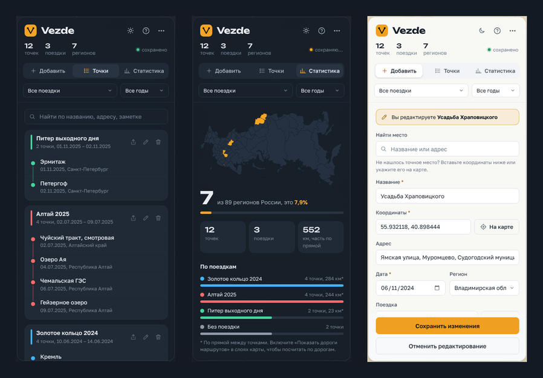

# Vezde

**Vezde — личный дневник путешествий на карте.** Отмечайте места, где побывали, собирайте их в поездки и смотрите весь свой путь на одной карте: по настоящим дорогам, с фото и заметками. Программа сама считает, сколько регионов России вы уже открыли, и показывает, куда ещё стоит съездить.

Подойдёт, если вы хотите:
- не терять воспоминания о поездках: где были, когда, что понравилось;
- видеть свою географию целиком и ставить цели «открыть все регионы»;
- делиться маршрутами с друзьями одним файлом.

Все данные хранятся только у вас на компьютере.



## Скачать

**[Скачать последнюю версию →](https://github.com/Subsonick/Vezde/releases/latest)**

На странице выпуска скачайте `Vezde.exe` и запустите. Установка не нужна. Нужен интернет для карты и поиска мест.

## Что умеет

- **Поиск места** по названию или адресу с подсказками, вставка координат из Яндекс или Google Карт, выбор точки щелчком по карте.
- **Поездки**: точки группируются по поездкам и выстраиваются по датам. Фильтры по поездкам и годам.
- **Маршруты по дорогам** со стрелками направления и пробегом.
- **Регионы России**: посещённые регионы закрашиваются на карте, на мини-карте в статистике и в списке «где ещё не были».
- **Фото** к точкам и поездкам, в том числе HEIC с iPhone. Если в фото есть геометка и дата, они подставятся сами.
- **Ачивки** за поездки, регионы, дальние маршруты.
- **Поделиться**: все поездки или только выбранные одним файлом, друг загружает его у себя.
- **Тёмная и светлая тема**, несколько видов карты (схема, рельеф, спутник).
- **Обучение** по кнопке «?» и **проверка обновлений** прямо в программе.

## Где хранятся данные

Всё хранится только у вас на компьютере, в папке `%APPDATA%\Vezde`: точки, поездки, уменьшенные копии фото, запасные копии (одна в день, последние 20). Никуда в интернет ваши данные не отправляются. Наружу уходят только запросы к картам, к поиску мест (OpenStreetMap / Photon) и к построению дорог (OSRM), а также проверка новой версии на GitHub.

Чтобы хранить данные рядом с программой, например на флешке, положите рядом с `Vezde.exe` пустой файл `portable.txt`.

## Обновление

Когда выйдет новая версия, Vezde покажет уведомление. Скачайте новый `Vezde.exe`, закройте программу и замените им старый файл. Данные хранятся отдельно и не пострадают. Перед первым запуском новой версии автоматически делается запасная копия.

## Удаление

Меню «⋯» → **«Удалить Vezde с компьютера»**. Или, если программа не запускается, файл **«Удалить Vezde.cmd»** в папке программы. Удаляются программа, все данные, запасные копии, кэш карт в AppData и ярлыки. Перед удалением можно сохранить копию данных. Ваши исходные фото и другие файлы не затрагиваются.

## Для разработчиков

Vezde построена на [Neutralinojs](https://neutralino.js.org/) и [Leaflet](https://leafletjs.com/). Весь интерфейс находится в папке `resources/`.

```bash
npm install
npm run setup   # скачать бинарники Neutralino в bin/
npm start       # запустить в режиме разработки
npm run build   # собрать dist/vezde/vezde-win_x64.exe с иконкой и версией
```

Номер версии хранится в `neutralino.config.json`. Формат файла данных задаётся константой `DATA_FORMAT` в `resources/app.js`: при изменении формата её нужно увеличить, а старые данные будут приведены к новому виду при загрузке.

## Авторы

- **Subsonick** — автор идеи и владелец проекта.
- **Claude** (Anthropic) — соавтор: разработка, дизайн и тексты.

## Благодарности

Карты © [OpenStreetMap](https://www.openstreetmap.org/copyright) и Esri. Поиск: Photon (komoot), Nominatim. Дороги: OSRM. Шрифты Unbounded и Golos Text (SIL Open Font License). Библиотеки: Leaflet, exifr, heic2any.

## Лицензия

[MIT](LICENSE)
